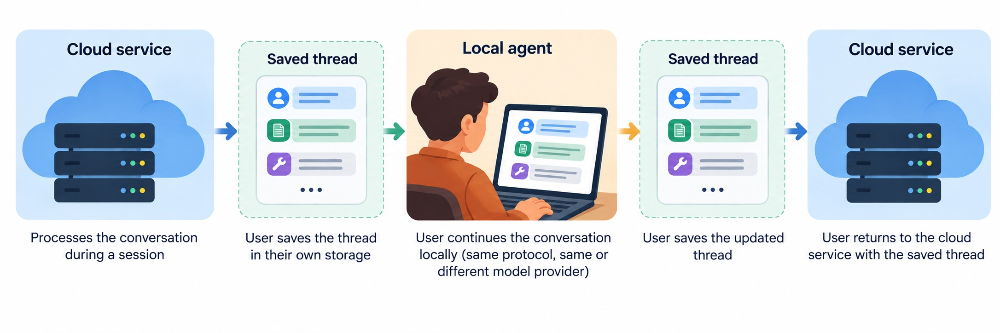

# The User Stores the Agent Thread. What Happens When It Comes Back?

*A practical look at saved conversations, integrity checks, local execution, and the limits of resume.*

Suppose you are building a cloud service for an AI assistant. You want users to keep their conversation history in storage they control. Your service processes a thread during a session, then returns it without keeping a complete transcript between sessions.

The next day, the user selects the thread from the conversation list and sends another message. The application sends the saved history and the new message to your service.

What should your backend do with it?

The obvious implementation parses the messages and sends them to the model. It restores `user`, `assistant`, and `tool` records, reconstructs call IDs, and resumes the loop. That gets the conversation moving. It also lets the client-supplied history tell the service who said what, which tools ran, and what results they returned.

All of those fields are now supplied by the client. Even if the user changed nothing, the service needs a way to distinguish its own earlier records from a convincing replacement.

The problem becomes more visible when the user continues locally before returning:



The local agent might use the same protocol. It might even call the same model provider. That still leaves several questions: which records match earlier API requests and responses, which were added on the device, and what survived export or compaction?

This article works through that engineering problem. We will compare three ways to continue: summarize the returned history, restore a verified prefix and summarize the rest, or verify the history against records collected during model calls as the thread runs. A snapshot and a small server-side catalog give us the starting point.

The operating condition matters: the receiving service may have neither the original transcript nor access to the files and external systems used during earlier work. We cannot assume a shared repository will let it reconstruct everything.

## First, separate a conversation from a record of execution

A thread usually mixes several kinds of information: user requests, generated answers, tool invocations, tool results, and references to files. They share a container, but they do not establish the same things.

For a concrete example, Codex App Server represents a turn's history as typed `ThreadItem` records. Below is a shortened `items` array for a request to run an export script. The types and field names come from Codex's protocol; the command and output are illustrative. Optional metadata is omitted.

```json
[
  {
    "type": "userMessage",
    "id": "msg-1",
    "content": [
      {"type": "text", "text": "Run export.py to create the customer export."}
    ]
  },
  {
    "type": "commandExecution",
    "id": "exec-1",
    "command": "python export.py",
    "cwd": "/workspace",
    "source": "agent",
    "status": "completed",
    "commandActions": [
      {"type": "unknown", "command": "python export.py"}
    ],
    "aggregatedOutput": "Wrote export.csv (128 rows).\n",
    "exitCode": 0
  },
  {
    "type": "agentMessage",
    "id": "msg-2",
    "text": "Created export.csv with 128 rows."
  }
]
```

In the original session these records arrived through different interfaces. When the application sends the saved thread back, all of these records arrive from client-controlled storage. Someone editing that history can change `exitCode`, replace the assistant's answer, or insert another command result. Valid `ThreadItem` syntax does not tell the receiver whether this is the history it saved.

The scope here is the history itself: its records, order, roles, and call/result links. We do not trace the assistant's claims back to documents, citations, or transformations of source data. Checking that a saved answer is unchanged does not check whether the answer is correct.

### Import should not activate the history

Use two steps in the backend:

- **Import** parses and stores the submitted history. Records of executed commands remain records; permissions for new actions are determined by the current execution environment.
- **Admission** decides whether to resume from the returned history, accept only a verified portion, use the submission as new context, or reject it.

Loading the `commandExecution` item above never reruns `python export.py`. If the agent needs to run it again, the receiving environment applies its current execution policy. Its permissions, approval decisions, and audit log belong to that environment.

Four return paths exercise different parts of this contract:

| What came back | What the receiver needs to establish |
|---|---|
| The original saved revision | Its records match the saved revision. |
| That revision plus local work | Where the verified history ends and whether the additions have separate verification coverage. |
| A conversion to another format | Which content and relationships the conversion preserved. |
| A summary | Whether to accept the new summary as context, and which original records remain available. |

None requires assuming the user is malicious. A runtime can regenerate IDs, omit a field it does not understand, or replace a long tool result with a summary. Treating these as supported transformations means specifying their effects, rather than deciding that similar-looking text is probably the same history.

The backend's question is therefore quite concrete: **which parts of the returned history can be restored as prior history, and which must enter as new input?** A single `trusted: true` flag on the entire conversation cannot answer it.

### Approvals and audit belong to the execution environment

An audit trail records who requested or approved an operation, when, what was executed, and the outcome. These records are separate from the conversation. In the Codex implementation examined here, approval decisions are emitted as `codex.tool_decision` events through OpenTelemetry logs when log export is configured; trace export alone does not export them. App Server handles approvals through separate RPC requests and responses. Returned thread items contain neither that audit trail nor references to its records.

Audit collection, protection, retention, and subsequent verification remain outside this article's scope. They belong to established log-management and audit practices, described in NIST SP 800-92 and the Audit and Accountability controls of SP 800-53. Thread transfer does not restore approvals or permissions. [NIST SP 800-92](https://csrc.nist.gov/pubs/sp/800/92/final), [NIST SP 800-53, AU controls](https://csrc.nist.gov/CSRC/media/Projects/risk-management/800-53%20Downloads/800-53r5/SP_800-53_v5_1-derived-OSCAL.pdf)

## Before adding signatures, decide what you need to recover

Sometimes the cheapest useful answer is to resume from a summary and inspect the work again.

For a coding task, the receiving agent may be able to retrieve the exact repository revision, read the diff, and run a fresh check. The summary tells it where to start. The repository supplies the code. The new execution supplies a current result.

This has a real product analogue: Claude Code Desktop documents moving a local session to the cloud with the conversation carried as a summary. Its transfer dialog separately describes whether files move. That establishes a supported transfer format; it does not document the security policy used to admit the summary. [Claude Code Desktop documentation](https://code.claude.com/docs/en/desktop#continue-in-another-surface)

Whether this is enough for your service depends on the work being resumed:

| What is available after transfer? | A practical continuation strategy |
|---|---|
| Exact artifacts, with cheap and repeatable checks | Load the artifacts, treat the summary as guidance, and check again. |
| Some original records are needed to continue | Retain and verify those records alongside the summary. |
| Only the thread, without access to the original artifacts | Preserve the history needed for continuation and verify what came back. |

Git helps with the first row. It can identify the code being examined. It does not reconstruct a tool response from a database that has since changed or a local file that was never committed. Running a query today establishes today's result. If the earlier response is needed as context, keep that record and its call ID through the transfer.

Our target architecture includes the third row. The service may lack access to the user's original documents, local files, or connector accounts. In that case, losing a particular record can mean losing the ability to continue a task as intended. Asking the model to reconstruct it supplies new text, not the missing record.

### Three ways to continue

An unchanged snapshot is the easy baseline: compare it with a hash saved by the service and restore the matching revision. There are three useful continuation strategies:

| Approach | What enters the next session | What you need |
|---|---|---|
| Summarize the history | A summary supplied as new user context | A compaction step and normal input controls |
| Verify a prefix, summarize the tail | The saved records before the saved offset, followed by a summary of the additions | A protected offset and prefix hash, plus compaction |
| Compare returned content with model-call evidence | Records or claims whose content and supported relationships match an observed call | Verification data for the call's ordered input and output |

For the third approach, one completed model call may be enough if its full input and output cover the context needed to continue. Material outside that call needs separate evidence or an explicit decision about whether to use it as new context.

The operator can retain the call's verification data in a server-side index or give the client a portable signed statement to return with the thread. The following sections work through both options.

Historical TLS session tickets offer a precedent for the baseline: clients hold server-protected state for later resumption. A readable thread needs its own format and rules, but client custody does not itself prevent integrity protection. [RFC 5077](https://www.rfc-editor.org/rfc/rfc5077.html)

## An unchanged snapshot is the easy case

When saving a thread, the service computes its hash and keeps that hash under the owner, thread, and revision identifiers. The user keeps the complete snapshot. On return, the service hashes the uploaded bytes and compares the result with its saved value.

The catalog entry can be this small:

```json
{
  "$schema": "https://json-schema.org/draft/2020-12/schema",
  "type": "object",
  "required": ["owner_id", "thread_id", "revision", "sha256"],
  "properties": {
    "owner_id": { "type": "string" },
    "thread_id": { "type": "string" },
    "revision": { "type": "string" },
    "sha256": { "type": "string", "pattern": "^[0-9a-f]{64}$" }
  }
}
```

The snapshot uses the runtime's existing history format. The catalog contains no messages or tool results. For an authenticated owner authorized to access the thread, the comparison is:

```python
from hashlib import sha256


def matches_saved_snapshot(catalog, owner_id, thread_id, revision, upload):
    entry = catalog.get((owner_id, thread_id, revision))
    if entry is None:
        return False
    return sha256(upload).hexdigest() == entry["sha256"]
```

A match identifies the saved bytes, not the latest revision or the correctness of the conversation. The service can parse and restore that snapshot under its current policy. A catalog error should propagate as an error rather than be reported as a mismatch.

The difficult case starts when the file has legitimately changed. The user may have continued locally, the runtime may have rewritten the JSON, or compaction may have replaced messages with a summary. The whole-file hash then fails without telling us which records changed.

For an extended thread, we need to answer two separate questions: **can we still verify the old part, and how do we accept the additions?**

## Restore the verified prefix and summarize the tail

Suppose the service exported 100 records and the user returns one array containing 120. The service can verify the first 100 without requiring a separate copy of the original snapshot.

At export, save a checkpoint containing the record offset and the hash of `records[:offset]`. The offset is measured in records, not bytes: `offset = 100` leaves the tail at `records[100:]`.

Store the checkpoint in the service catalog under the authenticated owner, thread, and exported revision. Both the offset and hash come from that saved entry, not from replacement values supplied by the uploader.

```json
{
  "$schema": "https://json-schema.org/draft/2020-12/schema",
  "type": "object",
  "required": ["offset", "prefix_sha256"],
  "properties": {
    "offset": { "type": "integer", "minimum": 0 },
    "prefix_sha256": { "type": "string", "pattern": "^[0-9a-f]{64}$" }
  }
}
```

The checkpoint hashes the record array, rather than the complete exported file. This example uses JCS at both export and return so that JSON whitespace and object-key order do not affect the comparison. Record values and array order remain significant. The Python package `rfc8785` supplies the canonical bytes. [RFC 8785](https://www.rfc-editor.org/rfc/rfc8785.html), [Python implementation](https://github.com/trailofbits/rfc8785.py)

```python
from hashlib import sha256
import rfc8785


def prefix_hash(records):
    return sha256(rfc8785.dumps(records)).hexdigest()


def make_checkpoint(records):
    return {
        "offset": len(records),
        "prefix_sha256": prefix_hash(records),
    }


def split_verified_prefix(records, checkpoint):
    # checkpoint was loaded from the authorized service catalog.
    offset = checkpoint["offset"]
    if len(records) < offset:
        raise ValueError("History is shorter than the saved prefix")

    prefix, tail = records[:offset], records[offset:]
    if prefix_hash(prefix) != checkpoint["prefix_sha256"]:
        raise ValueError("Saved prefix was changed")

    return prefix, tail  # Verification has not admitted the tail.
```

The code assumes parsed, validated runtime records. Rewritten IDs or compaction within the prefix invalidate the match. If it fails, ask for the original snapshot or offer continuation from a summary of the whole submission.

### Keep the first 100 records; summarize the next 20

Once the prefix matches, restore those 100 records unchanged. Compact only the 20 records from the offset onward and append their summary as a new user-context message. The summary describes the local continuation; it does not recreate its assistant turns or tool results as recorded history.

Save the checkpoint after pending tool calls have completed, so that summarizing the tail does not separate calls from their results.

Compaction reduces detail, not the need for normal input controls. The resulting summary remains supplied context. After accepting it, the service can save the restored prefix and the new summary message as a new revision. A later hash match will recognize that revision, including the summary as a user-context message.

This can be the complete design: the saved prefix is restored, and the local continuation enters as a summary. The next approach changes how verification data is collected: instead of recognizing only an exported revision, the service records what it observes during model calls and uses those records to verify the whole history.

## Verify the context of a model call

A service can also recognize returned content against observations made at the inference interface. Introduce an operator-controlled proxy: the agent sends model requests through it, and it forwards requests and relays response streams. The proxy can record the ordered input it received and output it delivered for each completed call.

Use the response identifier exposed at the agent-facing interface to retrieve that call's verification record. The authenticated API account scopes access to it. The proxy needs no agent thread ID, global history offset, or knowledge of which conversation the runtime is saving.

First consider a runtime that saves the same API items used at this interface. User messages, assistant messages, function calls, and results remain separate objects.

### Record complete input and output arrays

Hash each entire API item in the agreed saved/replayable representation, using JCS before SHA-256. Include its type, role where present, content, function arguments or result, and call ID. An `arguments` value remains a string: rewriting the JSON inside that string changes this whole-item hash.

If output-to-input conversion removes output-only fields, apply that agreed conversion before hashing output items. The verification record covers these represented items, not SSE delta boundaries or every field of the HTTP request. The input and output arrays remain separate and ordered.

There is no deduplication across calls. When the agent sends earlier items again, those items belong to the new request's input too. Their positions are local to that array. This matches client-managed conversation state, where earlier input and output are sent with the next request. [Conversation state](https://developers.openai.com/api/docs/guides/conversation-state)

### Follow the same two model calls

Both requests use `stream: true`, send the accumulated context in `input`, and use neither `previous_response_id` nor a provider-managed conversation.

The first input contains the user's request to run `export.py`. The response introduces a function call, streams its arguments, and supplies the finalized item at `response.output_item.done`:

```json
{
  "type": "function_call",
  "call_id": "call-1",
  "name": "exec_command",
  "arguments": "{\"cmd\":\"python export.py\",\"workdir\":\"/workspace\"}"
}
```

The agent executes the command locally and constructs the result:

```json
{
  "type": "function_call_output",
  "call_id": "call-1",
  "output": "Chunk ID: abc123\nWall time: 0.1000 seconds\nProcess exited with code 0\nOutput:\nWrote export.csv (128 rows).\n"
}
```

The second input includes the user message, function call, and result. The model streams the final answer, “Created export.csv with 128 rows.” The proxy captures finalized output items and publishes a completed-call record after successful response completion. An interrupted stream does not become a completed-call record. [Streaming function calls](https://developers.openai.com/api/docs/guides/function-calling#streaming)

| Completed call | Full request input | Finalized response output |
|---|---|---|
| `resp-1` | User message | Function call |
| `resp-2` | User message, function call, tool result | Assistant answer |

For this example, the second call alone covers all four records as input plus output. The first call's output is repeated in the second call's input. No cross-call history ledger is necessary to establish what the second call contained.

### Compare a returned call with the operator's record

The index key is the authenticated API subject and response ID. The caller supplies candidate input and output arrays; the receiver compares them with the recorded arrays in full, including their lengths and order:

```python
from hashlib import sha256
import rfc8785


def item_hash(item):
    return sha256(rfc8785.dumps(item)).hexdigest()


def record_call(subject, response_id, input_items, output_items):
    return {
        "sub": subject,
        "response_id": response_id,
        "request": [item_hash(item) for item in input_items],
        "response": [item_hash(item) for item in output_items],
    }


def verify_call(input_items, output_items, evidence, subject, response_id):
    if (evidence["sub"], evidence["response_id"]) != (subject, response_id):
        raise ValueError("Wrong API subject or response")
    candidate = record_call(subject, response_id, input_items, output_items)
    if candidate != evidence:
        raise ValueError("Input or output differs from the observed call")
    return {"request": input_items, "response": output_items}
```

At capture, the proxy stores `record_call(...)` under `(subject, response_id)`. At return, the receiver obtains `evidence` from that protected index, not from an unauthenticated upload. Changing an item, moving it within an array, deleting it, or moving it from request to response fails the comparison.

A match establishes the role values and order presented in that call. An assistant item in its input is authenticated as client-supplied context; it is not thereby proved to be an earlier model output. Establishing that stronger property requires evidence of the corresponding earlier response. The current output is covered as output delivered by the proxy. A tool result in the input remains a report received from the client, not proof of local execution.

### Where this representation is available

With a Responses backend, OpenAI Agents SDK exposes a saved/replayable history interface through `result.to_input_list()`. This makes it a useful example for defining the representation to be compared; the verification index is an application addition. [Agents SDK results](https://openai.github.io/openai-agents-python/results/)

The capture and export paths must use the same output-to-input conversion. SDK conversion, for example, removes some output-only fields. [SDK conversion code](https://github.com/openai/openai-agents-python/blob/main/src/agents/items.py#L205-L237)

The next section moves the expected hashes out of the operator's index and into signed evidence held by the user. We then examine how a runtime's own thread export differs from the input and output of a model call.

## Keep the verification record with the user

Instead of retaining the per-call record only in its index, the proxy can sign it and deliver it to the client. A receiver that trusts the signing key can verify the input and output later without querying that index.

The signature protects the expected hashes when they travel alongside client-held content. DSSE, the Dead Simple Signing Envelope, authenticates a serialized payload and its application-specific type. Our payload describes one observed model call. [DSSE protocol](https://github.com/secure-systems-lab/dsse/blob/master/protocol.md)

### Sign one completed call

Use the record from section 5: API subject, response identifier, ordered hashes of the complete request input, and ordered hashes of the completed output. The subject comes from the proxy's authentication context. It identifies the API account, not ownership of an agent thread.

For `resp-2`, `request` has three hashes: user message, function call, and tool result. `response` has one: the final assistant answer. The hashes preserve positions within each array.

```json
{
  "$schema": "https://json-schema.org/draft/2020-12/schema",
  "type": "object",
  "required": ["sub", "response_id", "request", "response"],
  "properties": {
    "sub": {"type": "string"},
    "response_id": {"type": "string"},
    "request": {"type": "array", "items": {"$ref": "#/$defs/sha256"}},
    "response": {"type": "array", "minItems": 1, "items": {"$ref": "#/$defs/sha256"}}
  },
  "$defs": {
    "sha256": {"type": "string", "pattern": "^[0-9a-f]{64}$"}
  },
  "additionalProperties": false
}
```

These fields are an illustrative application schema, not a DSSE-defined inference protocol. The payload type identifies that schema and the agreed whole-item encoding. Each statement stands on its own. Selecting evidence from several calls does not automatically prove that they belong to one runtime thread.

### Issue and verify the envelope

For a single-signature Ed25519 example, the keys below are objects from Python's `cryptography` package. The receiver gets the trusted public key from configuration.

```python
from base64 import b64decode, b64encode

PAYLOAD_TYPE = "https://example.com/inference-call/v1-json"


def pae(body, payload_type=PAYLOAD_TYPE):
    kind = payload_type.encode("utf-8")
    return b"DSSEv1 %d %s %d %s" % (len(kind), kind, len(body), body)


def sign_dsse(body, signing_key, payload_type=PAYLOAD_TYPE):
    return {
        "payloadType": payload_type,
        "payload": b64encode(body).decode("ascii"),
        "signatures": [{"sig": b64encode(signing_key.sign(pae(body, payload_type))).decode("ascii")}],
    }


def verified_dsse_payload(envelope, trusted_key, payload_type=PAYLOAD_TYPE):
    if envelope["payloadType"] != payload_type:
        raise ValueError("Unsupported statement type")
    body = b64decode(envelope["payload"], altchars=b"-_", validate=True)
    signature = b64decode(envelope["signatures"][0]["sig"], altchars=b"-_", validate=True)
    trusted_key.verify(signature, pae(body, payload_type))
    return body
```

Serialize `record_call(...)` with JCS and pass the bytes to `sign_dsse`. Store the envelope with the represented items. On return, verify its type and signature, parse the exact verified bytes with duplicate-key rejection, and validate the JSON Schema above. Then use `verify_call` from section 5 to compare the submitted arrays with the signed record.

Changing the tool output fails its item hash. Reordering input items fails the ordered-array comparison. Replacing the response identifier or either hash array inside the envelope fails its signature. A valid record for `resp-1` cannot substitute for `resp-2` when the caller requires the latter. Choosing an older valid call does not establish that it was the latest call in an external thread.

The envelope can be issued at response completion and delivered immediately, or retained for authorized retrieval by response ID. This is a proposed proxy capability. It is not a built-in Responses API evidence endpoint. A later retrieval returns evidence prepared from the observed call; it must not sign a newly supplied history as though it had observed it earlier.

The next question concerns the object returned by the agent: its own thread transcript may no longer contain the API items in this representation.

## Separate the thread from the model context

The previous examples assumed that the runtime retained API items in a comparable representation. Codex App Server exposes a different transcript. That difference reveals a distinction we also need when the formats agree: the runtime's thread and the input of a model call are separate objects.

### Name the objects before connecting them

Here, a **thread** is the conversation and execution history managed by an agent runtime. The runtime assigns its identity, groups work into turns, records messages and tool activity, and decides where to continue. Its **transcript** is a serialized view of that history, such as the App Server items in section 1. It need not contain every detail of the runtime's state.

The **model context** is what the runtime supplies for a particular inference request. In our client-managed example, we verify the request's ordered `input` items. Other request fields need their own coverage if they matter to the intended claim. The **response output** contains the items returned by that model call and is separate from its input.

The runtime builds a model request from its thread. It then incorporates the response into its history and may execute tools before making another request. An inference proxy observes those requests and responses; it does not thereby learn the runtime's thread identity.

Two threads can send identical input. One thread can send different input after compaction or context selection. An ordered array of API items therefore does not identify a thread, even when the runtime stores exactly those items. [Client-managed conversation state](https://developers.openai.com/api/docs/guides/conversation-state)

For a concrete format difference, the proxy can observe this output message:

```json
{
  "type": "message",
  "id": "msg-api-1",
  "role": "assistant",
  "status": "completed",
  "content": [
    {
      "type": "output_text",
      "text": "Created export.csv with 128 rows.",
      "annotations": []
    }
  ]
}
```

The runtime can export its answer as:

```json
{
  "type": "agentMessage",
  "id": "msg-2",
  "text": "Created export.csv with 128 rows."
}
```

Both contain the same answer text. Neither the common text nor the different IDs establishes which runtime thread contains it. The runtime knows that association; the receiver must verify the content it proposes to restore.

### One full call can cover the retained context

In the export-script example, the first call receives the user message and returns a function call. The second receives the user message, function call, and tool result, then returns the final answer. Evidence for the second call covers all four records in that example, across its input and output.

When a completed call's full input includes everything needed for continuation, its evidence can be sufficient. The response output must be covered too: the final answer is not already present in its own request.

This establishes what the client presented and what the proxy delivered for that call. An assistant item found only in the input remains authenticated as supplied context. Proving that it was generated in an earlier call requires evidence of that earlier output.

The same limit applies to compaction: a call containing a summary covers that summary, not the old records it replaced. Records added after the selected call are also outside its coverage. The worked path assumes full input at the proxy; a delta-only transport needs a separate way to establish the resolved context.

### Let the runtime connect the export to the call

The admission question is now concrete: **can evidence of an inference call support accepting a thread supplied by an external runtime?** A possible integration works as follows:

1. The proxy prepares evidence from the complete input and finalized output as each call completes. It identifies the call by the response ID exposed to the agent and scopes access to the authenticated API account.
2. When saving, the runtime fixes the exported revision and selects the completed call that corresponds to it. This association lives in the runtime, not in the proxy.
3. The runtime obtains that call's evidence and stores it with the transcript. A proposed retrieval interface can use the response ID; it is an extension to our proxy, not a standard Responses API evidence endpoint.
4. On return, the receiving service verifies the evidence and compares its covered values with values extracted from the submitted transcript. The runtime's claim that this is the right evidence is not sufficient on its own.
5. The service restores only what that comparison supports. Uncovered records require an explicit choice such as admission as supplied context or rejection.

A save or unsubscribe handler could trigger this process after the completed call and saved revision have been selected. The lifecycle event itself is not evidence. Retrieval must return material prepared from the observed call, rather than sign a newly uploaded transcript as though the proxy had seen it earlier.

### Choose what the evidence must preserve

A whole-item digest works when the saved API object survives. With a different runtime representation, we could retain a template of that object with its text removed, insert the returned text, and check the original digest. That works, but every verifier receiving the template also sees its retained metadata. IDs, annotations, and other fields can themselves be sensitive.

Instead, we can protect selected claims: message text and role, function name and arguments, or result content, bound to their position within the observed request or response. Each interface then extracts those claims, without reconstructing the original API object. Values removed or rewritten during export still cannot pass as the originals.

We need a portable format that authenticates those claims, allows sensitive values to remain with the user, and supports their later disclosure. Predictable values also need protection against guessing from a published digest. SD-JWT supplies a mechanism based on salted disclosures. The next section implements this call-level evidence with a ready-made library.

## Issue and disclose model-call evidence with SD-JWT

The previous section identified the evidence we need: one completed call's input and output, accessible by response ID and comparable with selected values in a runtime export. SD-JWT, Selective Disclosure for JSON Web Tokens, supplies a signed format with salted disclosures. The thread-to-call association remains the runtime's responsibility. [RFC 9901](https://www.rfc-editor.org/rfc/rfc9901.html#section-3.1)

### Choose the claims and their disclosure policy

This application profile records the issuer (`iss`), authenticated API account (`sub`), issuance time (`iat`), response ID, and ordered `request` and `response` arrays. The arrays represent the complete input and completed output of that call. They do not contain only new items: the second call repeats the user message and function call in its input.

Keep that call context and the item types, roles, and call IDs open and signed. Make message `text`, function `name` and `arguments`, and result `output` disclosable. The example uses an opaque API-account reference. Sensitive bindings can also be made disclosable if required before their corresponding checks. These are application choices; SD-JWT defines the protection and disclosure format.

A role in `request` describes context submitted by the client. It does not assert that the proxy generated that historical item. Array position and request/response membership remain protected by the containing signed structure. The runtime's thread identity is outside this evidence.

The following JSON Schema describes the required claims after disclosure. Arguments and results remain opaque API strings; the proxy does not interpret individual tools.

```json
{
  "$schema": "https://json-schema.org/draft/2020-12/schema",
  "type": "object",
  "required": [
    "iss",
    "sub",
    "iat",
    "response_id",
    "request",
    "response"
  ],
  "properties": {
    "iss": {
      "type": "string"
    },
    "sub": {
      "type": "string"
    },
    "iat": {
      "type": "integer",
      "minimum": 0
    },
    "response_id": {
      "type": "string"
    },
    "request": {
      "type": "array",
      "items": {
        "$ref": "#/$defs/observation"
      }
    },
    "response": {
      "type": "array",
      "minItems": 1,
      "items": {
        "$ref": "#/$defs/observation"
      }
    }
  },
  "additionalProperties": false,
  "$defs": {
    "observation": {
      "oneOf": [
        {
          "type": "object",
          "required": [
            "type",
            "role",
            "text"
          ],
          "properties": {
            "type": {
              "const": "message"
            },
            "role": {
              "enum": [
                "user",
                "assistant"
              ]
            },
            "text": {
              "type": "string"
            }
          },
          "additionalProperties": false
        },
        {
          "type": "object",
          "required": [
            "type",
            "call_id",
            "name",
            "arguments"
          ],
          "properties": {
            "type": {
              "const": "function_call"
            },
            "call_id": {
              "type": "string"
            },
            "name": {
              "type": "string"
            },
            "arguments": {
              "type": "string"
            }
          },
          "additionalProperties": false
        },
        {
          "type": "object",
          "required": [
            "type",
            "call_id",
            "output"
          ],
          "properties": {
            "type": {
              "const": "function_call_output"
            },
            "call_id": {
              "type": "string"
            },
            "output": {
              "type": "string"
            }
          },
          "additionalProperties": false
        }
      ]
    }
  }
}
```

### Let the library construct and verify disclosures

For each selected object property, the issuer generates a random salt and base64url-encodes the UTF-8 JSON `[salt, claim_name, claim_value]`. The digest of that encoded string goes in the containing object's `_sd` array, replacing the clear property. The issuer signs the resulting JWT and gives the client the JWT and disclosures. The client can later present selected disclosures; the verifier checks the signature and their signed digests and recovers the claims. [RFC 9901, disclosures](https://www.rfc-editor.org/rfc/rfc9901.html#section-4.2)

Use OpenWallet Foundation's reference API rather than implementing disclosure encoding or hashing. This executable example pins `sd-jwt==0.10.4` and uses `jwcrypto` for keys and `jsonschema` for the application schema. The reference release predates the final RFC and has verification limitations described below. This variant uses JWS directly, rather than nesting inside section 6's DSSE envelope. [Python implementation](https://github.com/openwallet-foundation-labs/sd-jwt-python), [pinned release](https://pypi.org/project/sd-jwt/0.10.4/)

### Extract claims at the proxy and issue the package

Install `sd-jwt==0.10.4` and `jsonschema`. `SDObj` marks a property for disclosure. The adapter below extracts selected claims from the proxy's own API contract and leaves API IDs, status, and annotations outside this profile. It supports one text block per message and the two function-related item kinds used in our example.

```python
from time import time
from jwcrypto.jwk import JWK
from sd_jwt.common import SDObj
from sd_jwt.issuer import SDJWTIssuer
from sd_jwt.holder import SDJWTHolder
from sd_jwt.verifier import SDJWTVerifier
from jsonschema import validate

ISSUER = "https://proxy.example"
TOKEN_TYPE = "inference-call-v1+sd-jwt"  # Our application profile.


def observation(item):
    kind = item["type"]
    if kind == "message":
        block, = item["content"]  # This example supports one text block.
        if block["type"] not in ("input_text", "output_text"):
            raise ValueError("Unsupported content block")
        return {"type": kind, "role": item["role"],
                SDObj("text"): block["text"]}
    if kind == "function_call":
        return {"type": kind, "call_id": item["call_id"],
                SDObj("name"): item["name"],
                SDObj("arguments"): item["arguments"]}
    if kind == "function_call_output":
        return {"type": kind, "call_id": item["call_id"],
                SDObj("output"): item["output"]}
    raise ValueError("Unsupported API item")


def issue_call(input_items, output_items, key, subject, response_id):
    claims = {
        "iss": ISSUER, "sub": subject, "iat": int(time()),
        "response_id": response_id,
        "request": [observation(item) for item in input_items],
        "response": [observation(item) for item in output_items],
    }
    issued = SDJWTIssuer(
        claims, key, sign_alg="ES256",
        extra_header_parameters={"typ": TOKEN_TYPE},
    )
    return issued.sd_jwt_issuance
```

Let `user`, `call`, `result`, and `answer` be the same API items used in the earlier example. The call and result are shown in section 5; the answer is shown in section 7. The second call's full input is `[user, call, result]`, and its output is `[answer]`:

```python
key = JWK.generate(kty="EC", crv="P-256")  # Demo; reuse the operator's key.
public_key = JWK.from_json(key.export_public())

client_package = issue_call([user, call, result], [answer], key,
                            "api-account-1", "resp-2")
```

The subject comes from the proxy's authenticated request context, and the response ID is the one exposed to the agent. Input is captured when received; output is assembled from the stream. Issue this completed-call package only after successful completion. Hashing individual deltas is unnecessary.

### Keep disclosures and salts with the client

The package contains the signed JWT and encoded disclosures. **The salt is inside each disclosure.** The client saves the package alongside the thread in storage that survives runtime export.

After delivery, the proxy can discard content and disclosures, including salts. A retained signed JWT contains digests and open context without the hidden values or salts. Keeping salts away from that retained copy prevents offline guessing of short undisclosed values from the digests. The proxy still sees the values during processing. [RFC 9901, salt requirements](https://www.rfc-editor.org/rfc/rfc9901.html#section-9.3)

If retrieval is delayed until the runtime saves its thread, the proxy must retain the ready package until it is retrieved or expires. That package contains the disclosed content. A strict no-content-retention design instead delivers it at call completion and relies on client storage; it cannot later regenerate discarded disclosures from a digest.

For this import, disclose all components required by the example's schema. The holder API preserves the original disclosures and salts:

```python
def present(issuance):
    holder = SDJWTHolder(issuance)
    selected = {"text": True, "name": True, "arguments": True, "output": True}
    holder.create_presentation({
        group: [selected for _ in holder.sd_jwt_payload[group]]
        for group in ("request", "response")
    })
    return holder.sd_jwt_presentation


presentation = present(client_package)
```

Omitting a required disclosure cannot produce successful claim validation. The original complete package can also be returned directly. There is no key-binding JWT here; the receiving service authenticates the caller separately. Possession of evidence does not grant access to another API account's records.

### Verify one call, then extract the returned claims

Pass the schema above as `schema`. The verifier uses a configured trusted key, checks the profile, subject, response ID, and issuance time, and obtains the disclosed claims. No thread identity or cross-call order is inferred:

```python
def verify_call_evidence(presentation, public_key, subject, response_id, schema):
    def issuer_key(issuer, header):
        if (issuer != ISSUER or header.get("alg") != "ES256"
                or header.get("typ") != TOKEN_TYPE):
            raise ValueError("Unaccepted issuer, algorithm, or profile")
        return public_key

    if not presentation.endswith("~"):
        raise ValueError("Expected SD-JWT without key binding")
    verifier = SDJWTVerifier(presentation, issuer_key)
    claims = verifier.get_verified_payload()
    validate(claims, schema)
    if (claims["sub"], claims["response_id"]) != (subject, response_id):
        raise ValueError("Wrong API subject or response")
    if claims["iat"] > time() + 60:
        raise ValueError("Issuance time is in the future")
    return claims
```

The pinned reference release leaves time checks to the application and accepts unreferenced disclosures, which RFC 9901 requires rejecting. This example checks `iat` and the required application claims; it issues no `exp` or `nbf`. These checks do not make the release a fully conforming production verifier. [Python implementation](https://github.com/openwallet-foundation-labs/sd-jwt-python), [RFC 9901, verification](https://www.rfc-editor.org/rfc/rfc9901.html#section-7.1)

Use the App Server transcript from section 1 as `returned`. Its adapter proposes message claims. Compare all such messages with the selected call's authenticated message claims in their order, retaining whether each was observed in request or response:

```python
def returned_message_claims(item):
    if item["type"] == "userMessage":
        block, = item["content"]
        if block["type"] != "text":
            raise ValueError("Unsupported user content")
        return {"type": "message", "role": "user", "text": block["text"]}
    if item["type"] == "agentMessage":
        return {"type": "message", "role": "assistant", "text": item["text"]}
    if item["type"] == "commandExecution":
        return None  # This example compares message claims only.
    raise ValueError("Runtime item outside this example")


def match_text_messages(returned, evidence):
    expected = [
        (group, index, item)
        for group in ("request", "response")
        for index, item in enumerate(evidence[group])
        if item["type"] == "message"
    ]
    actual = []
    for index, item in enumerate(returned):
        candidate = returned_message_claims(item)
        if candidate is not None:
            actual.append((index, candidate))
    if len(actual) != len(expected):
        raise ValueError("Message sequence differs")
    matches = []
    for (group, item_index, authenticated), (index, candidate) in zip(expected, actual):
        if candidate != authenticated:
            raise ValueError("Returned claims differ from the signed claims")
        matches.append({
            "runtime_index": index, "message_type": group, "item_index": item_index,
            "role": authenticated["role"], "text": authenticated["text"],
        })
    return matches


evidence = verify_call_evidence(presentation, public_key,
                               "api-account-1", "resp-2", schema)
matched_messages = match_text_messages(returned, evidence)
```

The matches identify the user message as part of `resp-2`'s request and the final assistant answer as part of its response. Positions refer to those arrays, not a proxy-maintained thread. Returned runtime IDs and other fields are outside this text comparison.

The bundle also authenticates the original function name, arguments, and result as call content. Comparing them with `commandExecution` or MCP records needs an adapter that can extract the selected values from that export. This example leaves the returned tool record uncovered. A neighboring message match cannot cover it; even a tool-result match would not prove execution on the device.

A match supports admission of the covered claims. It does not establish that the chosen call was the latest in an external thread, recover records replaced by a summary, or cover work added afterward. Those are separate conditions of the receiving service's continuation policy.

## Conclusion

User-held threads can support continuation without a server-side copy of the conversation. What the receiving service can restore depends on the evidence captured during the original work and on what survives the transfer.

An unchanged snapshot needs a protected reference digest. A verified prefix can be restored while later work enters as a summary. A proxy can also record individual calls in an index or issue signed evidence that travels with the user. One call can cover the retained context when its full input and output contain the necessary content.

When runtime formats differ, selected claims provide a more useful verification target than complete API objects. SD-JWT supplies a standard way to sign commitments and disclose their values. The application chooses the claims, defines their representation, and extracts them at each interface. Disclosures and their salts can remain with the user's data.

The runtime manages the thread and selects the corresponding call evidence. The receiver checks the submitted content against that evidence before admission. When the user sends the next message in that thread, the service can restore the records or claims the comparison covers and handle the remainder explicitly as supplied context or reject it. The receiving environment still controls every new action.
